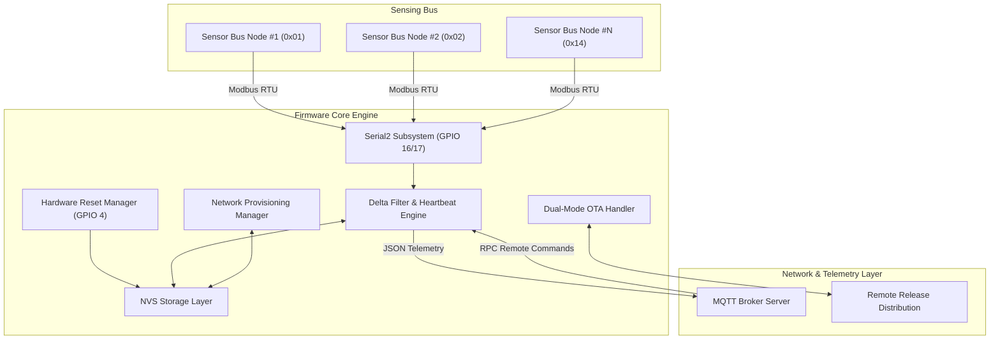

# AlfaEnergy - Multi-Channel Energy Monitoring Firmware

[](https://github.com/buildingprocess25/AlfaEnergy)
[](https://github.com/buildingprocess25/AlfaEnergy)
[](https://github.com/buildingprocess25/AlfaEnergy)
[](LICENSE)
[](https://github.com/rohidfkra777)
[](https://github.com/buildingprocess25)

Dokumentasi spesifikasi teknis dan arsitektur firmware **AlfaEnergy**, sistem pemantauan energi listrik multi-saluran (*multi-channel energy monitoring system*) berbasis mikrokontroler 32-bit ESP32 dan modul sensor daya AC PZEM-004T v3.0.

Firmware ini dirancang dan dikembangkan oleh [**rohidfkra777**](https://github.com/rohidfkra777) untuk lingkungan [**buildingprocess25/AlfaEnergy**](https://github.com/buildingprocess25/AlfaEnergy).

---

## 📋 Spesifikasi Sistem

| Parameter | Spesifikasi Teknis |
| :--- | :--- |
| **Platform Mikrokontroler** | ESP32 Dual-Core Tensilica Xtensa 32-bit LX6 |
| **Sensor Interface** | PZEM-004T v3.0 via Hardware Serial UART2 (Modbus RTU) |
| **Kapasitas Bus Sensor** | Hingga 20 unit sensor fisik ter-alamat (`0x01` s/d `0x14`) |
| **Alokasi Kanal Aktif** | Hingga 5 kanal dinamis per node unit |
| **Mode Pengukuran** | 3-Phase (`R`, `S`, `T`) dan 1-Phase (kategorisasi beban & nomor unit) |
| **Protokol Telemetri** | MQTT (JSON payload, QoS 0/1) |
| **Mekanisme Pelaporan** | Delta-Threshold Engine + 60s Periodic Heartbeat |
| **Penyimpanan Konfigurasi** | Non-Volatile Storage (NVS) Flash via Preferences API |
| **Pembaruan Firmware** | Local ArduinoOTA (Port 3232) & Remote GitHub Releases OTA |
| **Fail-Safe** | Dedicated Hardware Reset Pin (GPIO 4, Long-Press Protection) |

---

## 🏛 Arsitektur Sistem



---

## ⚙️ Karakteristik Teknis & Modul Firmware

### 1. Delta-Threshold Reporting & Heartbeat
Untuk mengoptimalkan efisiensi bandwidth jaringan, firmware menerapkan filter perubahan nilai terhadap pembacaan sensor:
- Tegangan: $\Delta V \ge 0.5\text{ V}$
- Arus: $\Delta A \ge 0.02\text{ A}$
- Daya Aktif: $\Delta W \ge 1.0\text{ W}$
- Frekuensi: $\Delta \text{Hz} \ge 0.1\text{ Hz}$
- Energi Kumulatif: $\Delta \text{kWh} \ge 0.001\text{ kWh}$
- Power Factor: $\Delta \text{PF} \ge 0.01$

Jika tidak ada parameter yang melewati ambang batas dalam rentang 60 detik, modul otomatis memicu paket *Heartbeat* guna memelihara status keaktifan node pada sistem pemantau pusat.

### 2. Konfigurasi Kanal Dinamis
Sistem mendukung klasifikasi kanal fleksibel yang tersimpan permanen di NVS:
- **Mode 3-Fasa (3P)**: Pemetaan langsung pada fasa `R`, `S`, atau `T`.
- **Mode 1-Fasa (1P)**: Pemetaan tipe beban (`AC`, `COOLER`, `LAMP`, `REFRIGERATOR`, `FREEZER`, `PUMP`, `MAIN`, `DISTRIBUTION`, `PRODUCTION`, `OTHER`) dengan identitas unit numerik (`01`–`10`).

### 3. Fail-Safe Hardware Reset
Pin GPIO 4 difungsikan sebagai interupsi reset perangkat keras dengan filter penekanan 5 detik (*active-low*). Mekanisme ini membersihkan konfigurasi kanal serta kredensial jaringan tanpa menghapus *Device ID* unik yang melekat pada unit.

---

## 🗂 Struktur Modul Berkas

```text
AlfaEnergy/
├── AlfaEnergy.ino         # Main firmware entry point (setup & loop orchestrator)
├── config.h               # Global configuration constants, thresholds, & endpoints
├── globals.h / .cpp       # Shared system objects, states, & timer definitions
├── device_id.h / .cpp     # Device ID validation, NVS persistent read/write
├── device_config.h / .cpp # Channel allocation validation & NVS serialization
├── wifi_provisioning.h / .cpp # Network management & captive portal engine
├── portal_banner.h        # Embedded graphical assets for provisioning interface
├── pzem_sensors.h / .cpp  # Modbus sensor polling, delta processing, & data dispatch
├── mqtt_handler.h / .cpp  # MQTT client, topic dispatcher, & command RPC interpreter
├── ota_update.h / .cpp    # Local network OTA & authenticated remote binary updater
├── channel_reset.h / .cpp # Hardware reset button debounce & trigger logic
└── utils.h / .cpp         # Time formatting utilities & NTP synchronization helpers
```

---

## 🔌 Referensi Pinout Perangkat Keras

| Fungsi | Pin ESP32 | Arah Logika | Keterangan |
| :--- | :---: | :---: | :--- |
| **UART RX (Sensor Bus)** | `GPIO 16` | Input | Terhubung ke TX sensor bus (Serial2) |
| **UART TX (Sensor Bus)** | `GPIO 17` | Output | Terhubung ke RX sensor bus (Serial2) |
| **Hardware Reset Input** | `GPIO 4` | Input (Pull-up) | Tombol reset fisik ke GND (Active-LOW, 5s hold) |
| **Serial Console Debug** | `GPIO 1` / `GPIO 3` | I/O | UART0 diagnostik (115200 bps) |

---

## 📡 Kamus Topik & Kontrak Protokol MQTT

Root prefix standar yang digunakan: `AlfaEnergy/<DEVICE_ID>`

### 1. Format Telemetri Pengukuran

- **3-Phase**: `AlfaEnergy/<DEVICE_ID>/3P/<PHASE>`
- **1-Phase**: `AlfaEnergy/<DEVICE_ID>/1P/<LOAD_TYPE>/<UNIT_NUMBER>`
- **Timestamp**: `AlfaEnergy/<DEVICE_ID>/Timestamp`

```json
{
  "V": 224.5,
  "A": 3.821,
  "W": 842.6,
  "Hz": 50.02,
  "kWh": 128.452,
  "pf": 0.981
}
```

### 2. Antarmuka Kendali & Diagnostik (RPC)

| Endpoint Topik | Fungsi Teknis |
| :--- | :--- |
| `.../cmd/getStatus` | Telemetri kesehatan node (IP, RSSI, free heap, uptime, kanal aktif) |
| `.../cmd/diagnostic` | Eksekusi swa-uji integritas hardware dan bus komunikasi |
| `.../cmd/scanPZEM` | Pemindaian bus alamat `0x01`–`0x14` untuk verifikasi sensor aktif |
| `.../cmd/getConfig` | Pengambilan payload konfigurasi kanal tersimpan |
| `.../cmd/getFeatures` | Kueri daftar kapabilitas modul firmware |
| `.../cmd/setChannel` | Penulisan ulang alokasi kanal secara remote |
| `.../cmd/addChannel` | Penambahan kanal sensor baru |
| `.../cmd/removeChannel` | Penghapusan kanal berdasarkan indeks |
| `.../cmd/resetEnergy` | Reset akumulator kWh pada modul pengukuran target |
| `.../cmd/setDeviceID` | Pembaruan pengenal unik node pada NVS |
| `.../cmd/setWiFi` | Konfigurasi kredensial jaringan nirkabel secara remote |
| `.../cmd/resetWiFi` | Pembersihan konfigurasi jaringan tersimpan |
| `.../cmd/restart` | Pemicu *software reset* ESP32 |
| `.../cmd/ota` | Pemicu pembaruan biner dari repositori rilis untuk satu unit |
| `AlfaEnergy/all/cmd/ota` | Pemicu pembaruan biner armada (*fleet broadcast*) |

---

## 👤 Pengembang & Repositori

- **Pengembang**: [rohidfkra777](https://github.com/rohidfkra777)
- **Repositori Organisasi**: [buildingprocess25/AlfaEnergy](https://github.com/buildingprocess25/AlfaEnergy)
- **Organisasi**: [buildingprocess25](https://github.com/buildingprocess25)

---

## 🔒 Hak Cipta & Lisensi

Seluruh kode sumber, arsitektur, dan aset pada repositori ini bersifat **Proprietary & Confidential** (Hak Cipta Dilindungi Undang-Undang). Dilarang keras menyalin, mengunduh, menduplikasi, memodifikasi, mendistribusikan, atau mengomersialisasikan tanpa izin tertulis dari [rohidfkra777](https://github.com/rohidfkra777).

Ketentuan lisensi lengkap tercantum pada berkas [LICENSE](LICENSE).
