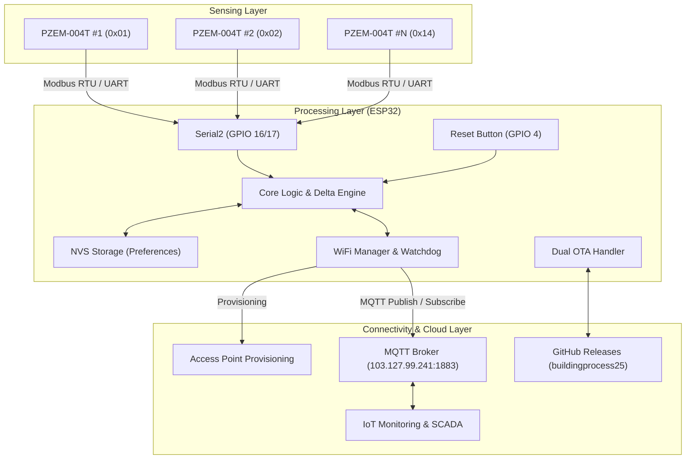

# ⚡ AlfaEnergy - IoT Energy Meter System

[](https://github.com/buildingprocess25/AlfaEnergy)
[](https://espressif.com/)
[](https://mqtt.org/)
[](https://github.com/rohidfkra777)
[](https://github.com/buildingprocess25)

**AlfaEnergy** adalah sistem pemantauan energi listrik cerdas (*IoT Smart Energy Meter*) berbasis mikrokontroler **ESP32** dan modul sensor daya **Peacefair PZEM-004T v3.0**. Sistem ini dirancang untuk pemantauan konsumsi daya listrik multi-saluran (*multi-channel*) pada lingkungan industri, gedung operasional, maupun jaringan gerai/toko (seperti gerai retail Alfamart).

Program ini dikembangkan oleh [**rohidfkra777**](https://github.com/rohidfkra777) dan dipublikasikan serta dikelola di repository resmi [**buildingprocess25/AlfaEnergy**](https://github.com/buildingprocess25/AlfaEnergy).

---

## 📑 Daftar Isi

- [Fitur Utama](#-fitur-utama)
- [Arsitektur & Diagram Sistem](#-arsitektur--diagram-sistem)
- [Spesifikasi Hardware & Pinout](#-spesifikasi-hardware--pinout)
- [Struktur File Firmware](#-struktur-file-firmware)
- [Kebutuhan Software & Library](#-kebutuhan-software--library)
- [Panduan Instalasi & Flashing](#-panduan-instalasi--flashing)
- [Konfigurasi Awal (Captive Portal)](#-konfigurasi-awal-captive-portal)
- [Protokol Komunikasi MQTT](#-protokol-komunikasi-mqtt)
  - [Topik Telemetri Sensor](#1-topik-telemetri-sensor)
  - [Topik Command & Kontrol Jarak Jauh](#2-topik-command--kontrol-jarak-jauh)
- [Mekanisme Over-The-Air (OTA) Update](#-mekanisme-over-the-air-ota-update)
- [Tombol Reset Fisik (Hardware Reset)](#-tombol-reset-fisik-hardware-reset)
- [Pengembang & Hak Cipta](#-pengembang--hak-cipta)

---

## ✨ Fitur Utama

1. **Multi-Channel & Multi-Phase Monitoring**
   - Mendukung pembacaan bus hingga **20 modul PZEM-004T** (alamat bus `0x01` s/d `0x14`).
   - Alokasi dinamis hingga **5 channel aktif** per node ESP32.
   - Mode fleksibel: **3-Fasa (3P)** dengan pemetaan fasa `R`, `S`, `T` dan **1-Fasa (1P)** dengan klasifikasi beban (`AC`, `COOLER`, `LAMP`, `REFRIGERATOR`, `FREEZER`, `PUMP`, `MAIN`, `DISTRIBUTION`, `PRODUCTION`, `OTHER`) serta nomor unit (`01` s/d `10`).

2. **Pengiriman Data Efisien (Delta-Based Reporting & Heartbeat)**
   - Data hanya dipublikasikan via MQTT jika terjadi perubahan nilai parameter melampaui ambang batas (*threshold*):
     - $\Delta V \ge 0.5\text{ V}$
     - $\Delta A \ge 0.02\text{ A}$
     - $\Delta W \ge 1.0\text{ W}$
     - $\Delta \text{Hz} \ge 0.1\text{ Hz}$
     - $\Delta \text{kWh} \ge 0.001\text{ kWh}$
     - $\Delta \text{PF} \ge 0.01$
   - Dilengkapi fungsi **Heartbeat** berkala (setiap 60 detik) untuk menjamin konektivitas node tetap terpantau meskipun beban stabil/tanpa perubahan.

3. **Smart WiFi Provisioning & Captive Portal Kustom**
   - Menggunakan portal penangkap (*captive portal*) interaktif berbasis `WiFiManager` dengan tampilan antarmuka eksklusif bertema Alfa Energy.
   - Konfigurasi mandiri tanpa hardcode: memasukkan SSID, Password WiFi, Device ID, serta konfigurasi Channel PZEM secara visual langsung dari browser smartphone/laptop.
   - Fallback otomatis ke AP Setup (`EnergyMeter-<DEVICE_ID>-Setup`) jika koneksi WiFi terputus atau konfigurasi belum lengkap.

4. **Dual OTA (Over-The-Air) Firmware Update**
   - **Local ArduinoOTA**: Update firmware via jaringan lokal pada port `3232` terproteksi sandi.
   - **Remote GitHub Releases OTA**: Pembaruan otomatis skala armada melalui internet. ESP32 mengunduh berkas biner rilis langsung dari repository GitHub [buildingprocess25/AlfaEnergy](https://github.com/buildingprocess25/AlfaEnergy) ketika menerima instruksi MQTT (`cmd/ota` atau broadcast `/all/cmd/ota`).

5. **Remote Fleet Diagnostics & Management (MQTT RPC)**
   - Scanning bus sensor PZEM (`cmd/scanPZEM`) untuk melacak modul yang terhubung di lapangan.
   - Re-konfigurasi saluran secara *real-time* tanpa re-flash (`setChannel`, `addChannel`, `removeChannel`, `resetChannel`).
   - Reset akumulator kWh sensor (`resetEnergy`).
   - Diagnostik mendalam status heap, memori, RSSI, IP, uptime, dan versi firmware (`getStatus`, `diagnostic`).
   - Manajemen konektivitas WiFi jarak jauh (`setWiFi`, `resetWiFi`, `resetAndSetWiFi`).

6. **Hardware Reset Button (Fail-Safe)**
   - Tombol fisik GPIO 4 dengan proteksi *long-press* (5 detik) untuk menghapus konfigurasi WiFi dan channel tanpa menghapus identitas permanen Device ID.

7. **Persistent Storage & NTP Synchronization**
   - Konfigurasi tersimpan aman pada Non-Volatile Storage (NVS) ESP32 menggunakan library `Preferences`.
   - Sinkronisasi waktu aktual secara otomatis dengan NTP Server (`pool.ntp.org`) dalam zona waktu Waktu Indonesia Barat (WIB / GMT+7).

---

## 🏗 Arsitektur & Diagram Sistem



---

## 🔌 Spesifikasi Hardware & Pinout

| Komponen / Jalur | Pin ESP32 | Pin Perangkat Eksternal | Keterangan |
| :--- | :---: | :---: | :--- |
| **PZEM RX** | `GPIO 16` | TX PZEM-004T | Jalur Serial Hardware 2 (Serial2) |
| **PZEM TX** | `GPIO 17` | RX PZEM-004T | Jalur Serial Hardware 2 (Serial2) |
| **Reset Button** | `GPIO 4` | Push Button ke `GND` | Mode `INPUT_PULLUP`, tekan 5 detik |
| **VCC Sensor** | `5V` | VCC PZEM & Optocoupler | Disarankan catu daya eksternal 5V stabil |
| **GND** | `GND` | GND PZEM & Modul | Common Ground |

> [!IMPORTANT]
> - Pastikan semua modul PZEM-004T yang dipasang secara paralel pada satu bus serial telah diubah alamat Modbus-nya secara unik antara `0x01` hingga `0x14` menggunakan tool scanner / address programmer sebelum dihubungkan bersamaan.
> - Hindari menggunakan port Serial0 (GPIO 1 dan 3) karena digunakan untuk serial monitor dan debugging flashing USB.

---

## 📁 Struktur File Firmware

```text
AlfaEnergy/
├── AlfaEnergy.ino         # Main entry point (setup & loop)
├── config.h               # Konfigurasi konstan (versi, server MQTT, pinout, delta)
├── globals.h / .cpp       # Deklarasi & inisialisasi objek serta variabel global
├── device_id.h / .cpp     # Pengelolaan Device ID pada NVS flash memory
├── device_config.h / .cpp # Logika konfigurasi fleksibel channel 1P & 3P
├── wifi_provisioning.h / .cpp # Captive portal WiFiManager dengan styling kustom
├── portal_banner.h        # Aset visual banner antarmuka captive portal
├── pzem_sensors.h / .cpp  # Engine akuisisi, validasi, dan publikasi data PZEM
├── mqtt_handler.h / .cpp  # Driver klien MQTT, handler topik, dan command parsing
├── ota_update.h / .cpp    # Handler ArduinoOTA (lokal) & GitHub Releases OTA (remote)
├── channel_reset.h / .cpp # Handler debounce dan logika tombol fisik reset
└── utils.h / .cpp         # Fungsi pembantu (timestamp WIB, format waktu)
```

---

## 💻 Kebutuhan Software & Library

### 1. Development Environment
- **Arduino IDE** (v1.8.19 / v2.x) atau **PlatformIO** (VS Code).
- **ESP32 Board Package**: Versi `2.0.x` atau lebih baru.
  - URL Board Manager: `https://raw.githubusercontent.com/espressif/arduino-esp32/gh-pages/package_esp32_index.json`

### 2. Pustaka Eksternal (Libraries)
Instal pustaka-pustaka berikut melalui *Library Manager* Arduino:
- [**WiFiManager**](https://github.com/tzapu/WiFiManager) (by tzapu, tested v2.0.17)
- [**PubSubClient**](https://github.com/knolleary/pubsubclient) (by Nick O'Leary)
- [**PZEM-004T-v30**](https://github.com/mandulaj/PZEM-004T-v30) (by Mandula)
- **ArduinoOTA**, **HTTPClient**, **Update**, **WiFiClientSecure**, **Preferences** *(Bawaan Core ESP32)*

---

## 🚀 Panduan Instalasi & Flashing

1. **Clone Repository**:
   ```bash
   git clone https://github.com/buildingprocess25/AlfaEnergy.git
   cd AlfaEnergy
   ```
2. **Buka Project**:
   - Buka file `AlfaEnergy/AlfaEnergy.ino` di Arduino IDE.
3. **Pengaturan Board Arduino IDE**:
   - Board: `ESP32 Dev Module`
   - Flash Size: `4MB (32Mb)`
   - Partition Scheme: `Default 4MB with spiffs (1.2MB APP/1.5MB SPIFFS)` atau `Minimal SPIFFS (1.9MB APP with OTA/190KB SPIFFS)`
   - Upload Speed: `921600` / `115200`
   - Port: Sesuaikan dengan port COM ESP32 Anda
4. **Compile & Upload**:
   - Tekan tombol **Verify** (Centang) untuk memastikan tidak ada dependensi yang kurang.
   - Tekan tombol **Upload** (Panah kanan) ke ESP32.

---

## 🌐 Konfigurasi Awal (Captive Portal)

Saat pertama kali di-flash (atau setelah dilakukan reset konfigurasi):
1. ESP32 otomatis mengaktifkan mode Access Point dengan nama:
   - `EnergyMeter-Setup` (jika Device ID belum terdaftar), atau
   - `EnergyMeter-<DEVICE_ID>-Setup` (jika Device ID sudah ada).
2. Hubungkan smartphone atau laptop ke Access Point tersebut dengan kata sandi:
   ```text
   AlfaEnergy
   ```
3. Buka browser dan kunjungi IP default:
   ```text
   http://192.168.4.1
   ```
4. Di halaman portal:
   - Pilih jaringan WiFi (SSID) dan masukkan Password.
   - Masukkan **Device ID** (misal: `EM-0001` atau `STORE-ALFA-042`).
   - Tambahkan dan atur **Channel Sensor**:
     - Pilih **PZEM Address** (`0x01` s/d `0x14`).
     - Tentukan **Mode**: `1P` (1-Fasa) atau `3P` (3-Fasa).
     - Jika `3P`: Tentukan fasa (`R`, `S`, atau `T`).
     - Jika `1P`: Pilih tipe beban (`AC`, `COOLER`, `LAMP`, `REFRIGERATOR`, `FREEZER`, dll) serta nomor unit (`01` s/d `10`).
5. Klik **Save**. ESP32 akan menyimpan konfigurasi ke NVS dan me-restart secara otomatis untuk terhubung ke jaringan operasional.

---

## 📡 Protokol Komunikasi MQTT

Prefix Root MQTT adalah: `AlfaEnergy/<DEVICE_ID>`

### 1. Topik Telemetri Sensor

#### **Mode 3-Fasa (3P)**
- **Topik**: `AlfaEnergy/<DEVICE_ID>/3P/<PHASE>`
  - Contoh: `AlfaEnergy/EM-0001/3P/R`, `AlfaEnergy/EM-0001/3P/S`, `AlfaEnergy/EM-0001/3P/T`

#### **Mode 1-Fasa (1P)**
- **Topik**: `AlfaEnergy/<DEVICE_ID>/1P/<LOAD_TYPE>/<UNIT_NUMBER>`
  - Contoh: `AlfaEnergy/EM-0001/1P/AC/01`, `AlfaEnergy/EM-0001/1P/COOLER/02`

#### **Contoh Payload JSON Telemetri**:
```json
{
  "V": 224.5,
  "A": 3.821,
  "W": 842.6,
  "Hz": 50.02,
  "kWh": 128.452,
  "pf": 0.981
}
```

#### **Timestamp Telemetri**:
- **Topik**: `AlfaEnergy/<DEVICE_ID>/Timestamp`
- **Payload**: String format waktu WIB (`YYYY-MM-DD HH:MM:SS`)

---

### 2. Topik Command & Kontrol Jarak Jauh

Publish instruksi ke topik di bawah ini untuk mengontrol node ESP32:

| Topik Command | Contoh Payload / Format | Deskripsi |
| :--- | :--- | :--- |
| `AlfaEnergy/<DEVICE_ID>/cmd/getStatus` | *(Payload kosong atau teks bebas)* | Meminta status lengkap node (IP, RSSI, versi firmware, status sensor, heap). |
| `AlfaEnergy/<DEVICE_ID>/cmd/diagnostic` | *(Payload kosong)* | Menjalankan self-diagnostic lengkap sistem dan jaringan. |
| `AlfaEnergy/<DEVICE_ID>/cmd/scanPZEM` | *(Payload kosong)* | Melakukan pemindaian bus alamat `0x01` s/d `0x14` untuk mendeteksi modul PZEM fisik yang aktif. |
| `AlfaEnergy/<DEVICE_ID>/cmd/getConfig` | *(Payload kosong)* | Meminta rincian channel yang saat ini aktif di ESP32. |
| `AlfaEnergy/<DEVICE_ID>/cmd/getFeatures` | *(Payload kosong)* | Meminta daftar kapabilitas firmware yang didukung node. |
| `AlfaEnergy/<DEVICE_ID>/cmd/restart` | *(Payload kosong)* | Me-restart ESP32 secara jarak jauh. |
| `AlfaEnergy/<DEVICE_ID>/cmd/resetEnergy` | `{"channel": 1}` atau `{"address": "0x01"}` | Mereset akumulasi nilai kWh pada modul sensor PZEM tertentu. |
| `AlfaEnergy/<DEVICE_ID>/cmd/setChannel` | JSON array channel konfigurasi baru | Mengubah konfigurasi channel secara remote. |
| `AlfaEnergy/<DEVICE_ID>/cmd/addChannel` | JSON objek channel baru | Menambahkan saluran pembacaan sensor baru. |
| `AlfaEnergy/<DEVICE_ID>/cmd/removeChannel`| `{"index": 0}` | Menghapus konfigurasi channel berdasarkan index. |
| `AlfaEnergy/<DEVICE_ID>/cmd/setDeviceID` | `NEW-DEVICE-ID` | Mengubah Device ID yang tersimpan di NVS. |
| `AlfaEnergy/<DEVICE_ID>/cmd/setWiFi` | `{"ssid":"NamaSSID","pass":"Password"}` | Memperbarui kredensial WiFi. |
| `AlfaEnergy/<DEVICE_ID>/cmd/resetWiFi` | *(Payload kosong)* | Menghapus data WiFi dan masuk ke Captive Portal. |
| `AlfaEnergy/<DEVICE_ID>/cmd/ota` | *(Payload kosong)* | Menjalankan pemeriksaan dan update firmware dari GitHub Releases. |
| `AlfaEnergy/all/cmd/ota` | *(Payload kosong)* | Perintah broadcast OTA serentak untuk seluruh armada perangkat di jaringan. |

---

## 🔄 Mekanisme Over-The-Air (OTA) Update

### 1. Remote OTA via GitHub Releases (Firmware Update Online)
Firmware memiliki mekanisme otomatis untuk mengunduh update langsung dari GitHub:
- **File Versi**: Mengacu pada [version.txt](https://raw.githubusercontent.com/buildingprocess25/AlfaEnergy/refs/heads/main/version.txt) di branch utama.
- **File Biner**: Mengunduh rilis `AlfaEnergy.ino.bin` dari tautan rilis [buildingprocess25/AlfaEnergy Releases](https://github.com/buildingprocess25/AlfaEnergy/releases/download/Firmware/AlfaEnergy.ino.bin).
- **Prosedur Eksekusi**:
  1. Publish pesan ke topik: `AlfaEnergy/<DEVICE_ID>/cmd/ota`.
  2. Node mengecek versi terbaru dari GitHub. Jika terdapat versi yang lebih baru daripada versi yang sedang berjalan, ESP32 mengunduh berkas biner secara aman melalui HTTPS dan mem-flashing dirinya sendiri.
  3. Node melakukan restart otomatis dengan firmware baru.

### 2. Local ArduinoOTA
- Hostname: Sesuai Device ID (misal `AlfaEnergy-EM-0001`).
- Sandi OTA: `AlfaEnergy`.
- Port: `3232`.

---

## 🔘 Tombol Reset Fisik (Hardware Reset)

Perangkat dilengkapi pin reset manual pada **GPIO 4**:
- Hubungkan push-button antara **GPIO 4** dan **GND**.
- **Cara Kerja**:
  - **Saat Boot / Normal Running**: Tekan dan tahan tombol selama **5 detik**.
  - ESP32 akan menghapus konfigurasi channel sensor dan kredensial WiFi.
  - **Device ID tetap dipertahankan**.
  - ESP32 akan membuka kembali **Captive Portal** agar teknisi dapat melakukan re-konfigurasi dengan mudah di lokasi instalasi.

---

## 👨‍💻 Pengembang & Hak Cipta

- **Penulis & Pengembang Program**: [rohidfkra777](https://github.com/rohidfkra777)
- **Repository Resmi Perusahaan**: [buildingprocess25/AlfaEnergy](https://github.com/buildingprocess25/AlfaEnergy)
- **Organisasi**: [buildingprocess25](https://github.com/buildingprocess25)

---
*Dikembangkan dengan dedikasi untuk keandalan monitoring efisiensi energi industri dan operasional ritel.*
